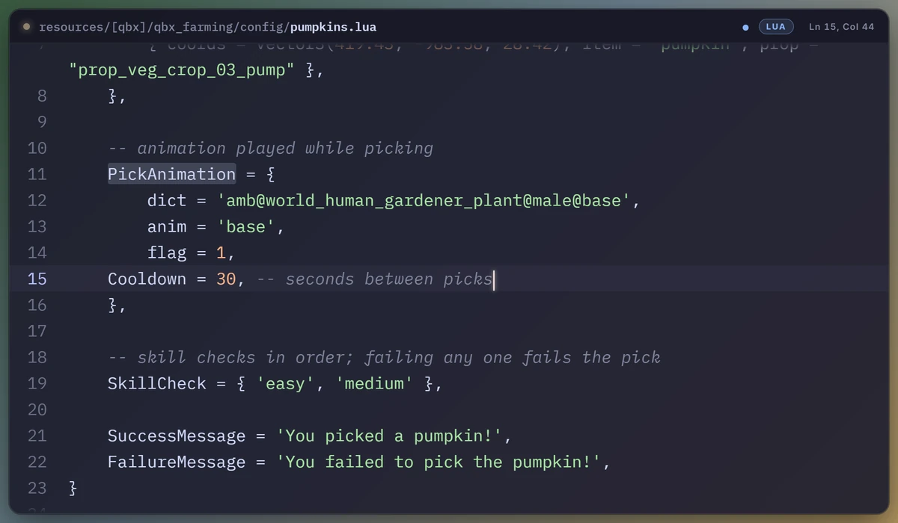

# Stream Code

**Website:** https://heyjeay.github.io/streamcode/ · **Download:** [latest release](https://github.com/heyjeay/streamcode/releases/latest) · **Support:** [Discord](https://discord.gg/8wwfPxfMWA)

Shows the file you are editing in VS Code as a clean, syntax-highlighted panel in OBS,
instead of capturing the VS Code window. Twelve themes, no tabs, sidebars, minimap or
squiggles, and readable at stream size.



The extension's own [README](extension/README.md) has the story and screenshots of the
themes, the 3D looks and the gallery; this file is the setup and tweaking guide.

```
VS Code  --(Stream Code extension)-->  http://127.0.0.1:7331  --(Server-Sent Events)-->  stream_code.html in OBS
```

The extension is the server. There is nothing to start before a stream: open VS Code
and the overlay is live.

## Files

| File | What it is |
| --- | --- |
| `stream_code.html` | the overlay, one self-contained page (served by the extension at `/`); `?gallery` turns it into the theme picker |
| `extension/` | the VS Code extension: `extension.js` (editor events + settings -> state), `server.js` (the local hub) |
| `build_vsix.py` | packages `extension/` + `stream_code.html` into a `.vsix` and installs it (stdlib only); see below for the README screenshots |
| `site/` | the website at https://heyjeay.github.io/streamcode/ (Vue 3 + Vite + Tailwind), deployed by `.github/workflows/pages.yml` |
| `install-stream-code.bat` | double-click version of the above |
| `publish-images.bat` | uploads the README screenshots to https://stream-code.pages.dev/ |
| `open-stream-code.bat` | opens the overlay in a browser with the debug HUD |

## Setup (once)

1. Run `install-stream-code.bat` (or `python build_vsix.py`). It builds `stream-code-<version>.vsix`
   and runs `code --install-extension` on it.
2. Reload VS Code: `Ctrl+Shift+P` -> **Developer: Reload Window** (new windows pick it up on their own;
   the first install even activates in open windows, but updates need the reload).
   A **Code** item appears at the right of the status bar.
3. In OBS add a **Browser** source:
   - URL: `http://127.0.0.1:7331/`
   - Width / height: whatever space you want it to take (900 x 560 is a good start; the panel
     fills the source and shows as many lines as fit)
   - Leave "Shutdown source when not visible" off so it stays connected.
4. Open any file in VS Code and type. The panel follows the cursor.

To position and size it without live code, add `?demo` to the URL: canned Lua types itself
in a loop.

### Screenshots on the extension page

VS Code shows an extension's README in a locked-down page that only displays images from a
public `https://` address: it strips `data:` images and relative paths like
`images/kick.webp`, so they appear broken. The screenshots in `extension/images/` therefore
are published to the Cloudflare Pages project `stream-code` (https://stream-code.pages.dev/),
and `IMAGES_BASE_URL` in `build_vsix.py` points the packaged README there as
`<base>/<file>?v=<version>`. After changing a screenshot, run `publish-images.bat`
(uploads `extension/images` with `npx wrangler`), then `install-stream-code.bat`. With
`IMAGES_BASE_URL` empty the build leaves the images out instead of showing broken ones. This README and the one in
`extension/` keep their relative paths, so they still show the images on GitHub and in
VS Code's markdown preview.

## Changing the look

All of it lives in VS Code settings, so nothing has to be typed into OBS:

- `Ctrl+Shift+P` -> **Stream Code: Pick a theme** gives a list of the themes.
- `Ctrl+Shift+P` -> **Stream Code: Settings** opens the settings page filtered to Stream Code:
  theme, header on/off, background on/off, line numbers, word wrap, font size, line height.
- `Ctrl+Shift+P` -> **Stream Code: Open the theme gallery** (or `http://127.0.0.1:7331/?gallery`)
  shows every theme side by side with the same code. Click one to use it; the toggles and
  size boxes at the top do the same as the settings. Everything there writes the VS Code
  settings through the extension, and the OBS source updates straight away.

The settings are the source of truth whenever the extension is connected. To make one OBS
source differ from another (say a second, bare one for a different scene), put URL options
on that source; they override the settings for that source only:

| Option | Effect |
| --- | --- |
| `?theme=kick` | theme (any name from the table below) |
| `?size=26` | font size in px |
| `?lh=1.8` | line height multiplier |
| `?wrap=0` | don't word-wrap long lines (they slide sideways to follow the caret instead) |
| `?nums=0` | hide line numbers |
| `?header=0` | hide the file-name bar |
| `?bg=0` | no panel background, border or shadow: the code floats over the game with a soft text shadow |
| `?clean` | `header=0` + `bg=0` in one: just the code |
| `?fade=25` | fade the code out over the top and bottom 25% of the overlay (0 = hard edges) |
| `?tiltx=15` `?tilty=-25` `?rot=3` | 3D: tilt forward/back, turn left/right, rotate, in degrees |
| `?persp=1200` `?scale=0.9` `?depth=16` `?float=1` `?opacity=0.9` | 3D: perspective distance, scale, fake thickness, hover motion, opacity |
| `?zoom=camera` / `?zoom=lens` | zoom in on what you point at or type: the whole view, or a magnifier |
| `?zoomfollow=both` `?zoomamt=1.8` `?zoomidle=5` | zoom: follow `both` / `mouse` / `cursor`, magnification, quiet seconds before zooming out |
| `?follow=0` | with wrap off: don't slide long lines sideways |
| `?demo` | canned Lua that types itself; add `&still` for one static frame |
| `?gallery` | the theme gallery / control panel |
| `?debug` | green HUD with connection state |

### 3D look

The same settings page (and the sliders in the gallery, which has a live half-size preview
of the real overlay) also angle the panel in 3D: **Tilt X** leans it forward or back,
**Tilt Y** turns it left or right, **Rotate** spins it in its plane, **Perspective** sets how
dramatic the foreshortening is (smaller = more), **Scale** shrinks it when a tilted panel
gets clipped by the browser source's edges, **Depth** gives it a fake thickness and a light
sheen so it reads as a solid slab, **Float** adds a slow hover, and **Opacity** fades the whole
thing. Something like tilt Y −22, tilt X 6, depth 14, scale 0.9 gives a game-HUD look; the
Terminal and Neon themes suit it well.

### Zoom

**Zoom** (settings page, or the zoom row in the gallery) magnifies the code you point at:
**Lens** is a magnifier over that spot, **Camera** zooms the whole view and pans after it.
**Follows** picks the target: the mouse, the text cursor, or whichever moved last (the
default, so it points where you point and jumps back to your typing). **Amount** is the
magnification and **Zoom out after** eases back to the full view after that many quiet
seconds (0 keeps it zoomed). Try `?demo&zoom=lens` to watch it chase a simulated mouse.

VS Code has no API for the mouse position. The extension registers a hover provider that
never shows anything: VS Code calls it whenever the mouse rests over code, with the position
under it, and clicks arrive as selection changes. So the zoom moves when the mouse settles
(about 300 ms, VS Code's hover delay), not on every pixel of movement.

### Themes

| Name | Design |
| --- | --- |
| `mocha` | Catppuccin Mocha, the same colours as the editor (default) |
| `kick` | black panel, Kick green, uppercase header like the song-request overlay |
| `twitch` | Twitch dark with purple accents |
| `terminal` | green phosphor CRT: VT323 font, scanlines, glow, block cursor |
| `paper` | light card with GitHub-style colours |
| `glass` | frosted translucent panel, pastel colours |
| `neon` | synthwave: pink and cyan with glow and a gradient top bar |
| `mac` | macOS-style window (traffic lights, centred title) with One Dark colours |
| `nord` | cool blue-grey, file name in an editor tab |
| `dracula` | the Dracula palette |
| `gruvbox` | warm retro, boxy corners, editor tab |
| `minimal` | no panel, no header, no numbers: white code with a shadow, straight over the game |

### Making your own theme

Open `stream_code.html` and copy one of the entries in the `THEMES` block near the top: a
theme is a set of colours (`vars`), syntax colours (`syn`), a header style (`head`: `bar`,
`tab`, `mac` or `none`), whether it wants a background and line numbers by default, how the
language badge is coloured (`badge`: `language` or `accent`) and optional effects (`fx`:
`blur`, `topbar`, `glow`, `scanlines`, `block-caret`, `square`). To make it selectable from
VS Code, add its name to the `streamCode.theme` enum in `extension/package.json` and to the
`THEMES` list at the top of `extension/extension.js`, then re-run `install-stream-code.bat`
and reload VS Code. (A theme that only exists in the HTML still works with `?theme=name`.)

While tweaking, set the VS Code setting `streamCode.overlayPath` to
the full path of `stream_code.html` in your clone: the extension then serves
the repo copy, so a refresh of the browser source shows every edit, no reinstall needed.

Syntax highlighting comes from highlight.js on cdnjs; with no internet the code still shows,
just in one colour. Fonts (IBM Plex Mono, JetBrains Mono, Fira Code, VT323, Inter) come from
Google Fonts with Consolas as the fallback.

## Using it on stream

- **Pause**: click the **Code** item in the status bar (or `Ctrl+Shift+P` ->
  *Stream Code: Pause / Resume broadcasting*). The panel fades out until you resume.
  Pause is shared by every VS Code window.
- **Private files**: anything matching `streamCode.hideFiles` is never sent. Defaults cover
  `.env*`, `*secret*`, `*credential*`, `*token*`, `*password*`, `*.pem`, `*.key`, `*.pfx`,
  `id_rsa*` and so on, which includes this repo's `kick-credentials.json`,
  `twitch-credentials.json` and `kick-tokens.json`. The overlay shows a lock card instead.
  Untitled scratch buffers *are* broadcast, so pause first if you paste something private.
- **Several VS Code windows**: the first one owns the port; the others hand their state to
  it whenever they are the focused window, so the overlay always shows the window you are
  typing in.
- **Following**: the panel centres on the cursor. If you scroll away from the cursor to read
  something, it follows the scroll instead. Long lines word-wrap onto extra rows.
- Only `127.0.0.1` is listened on, nothing leaves the PC.

## Extension settings

| Setting | Default | |
| --- | --- | --- |
| `streamCode.theme` | `mocha` | overlay theme |
| `streamCode.showHeader` | `true` | file-name bar |
| `streamCode.showBackground` | `true` | panel background, border and shadow |
| `streamCode.showLineNumbers` | `true` | line numbers |
| `streamCode.wordWrap` | `true` | wrap long lines |
| `streamCode.fontSize` | `22` | code font size in px |
| `streamCode.lineHeight` | `1.6` | line height multiplier |
| `streamCode.edgeFade` | `4` | % of the height that fades out at the top and bottom (0 = hard edges) |
| `streamCode.tiltX` / `tiltY` / `rotate` | `0` | 3D angles in degrees |
| `streamCode.perspective` | `1200` | 3D perspective distance in px |
| `streamCode.scale` | `1` | scale of the whole panel |
| `streamCode.depth` | `0` | fake thickness in px (0 = flat) |
| `streamCode.float` | `false` | slow hovering motion |
| `streamCode.opacity` | `1` | opacity of the whole panel |
| `streamCode.zoom` | `off` | `camera` or `lens` |
| `streamCode.zoomFollow` | `both` | `both`, `mouse` or `cursor` |
| `streamCode.zoomAmount` | `1.8` | magnification, 1.1 to 4 |
| `streamCode.zoomOutAfter` | `0` | quiet seconds before zooming out (0 = never) |
| `streamCode.port` | `7331` | local port |
| `streamCode.bufferLines` | `50` | lines sent above and below the cursor (scroll buffer) |
| `streamCode.maxLineLength` | `400` | longer lines are cut before sending |
| `streamCode.hideFiles` | see above | globs that are never broadcast |
| `streamCode.overlayPath` | empty | serve this HTML file instead of the bundled one |

## Publishing to the VS Code Marketplace

1. Sign in at https://marketplace.visualstudio.com/manage with a Microsoft account and
   create a publisher whose ID is `heyjeay` (it must match `publisher` in
   `extension/package.json`).
2. `python build_vsix.py --marketplace` packages the extension with Microsoft's `vsce`
   (through `npx`, nothing to install) into `stream-code-<version>-marketplace.vsix`.
   It refuses to run without `IMAGES_BASE_URL`, since the Marketplace page only shows
   https images.
3. On the manage page: **New extension -> Visual Studio Code**, upload that `.vsix`.
   The Marketplace scans it for a few minutes before it goes live.

For an update, raise `version` in `extension/package.json`, add a line to
`extension/CHANGELOG.md`, rebuild with `--marketplace`, and upload it with **Update** from
the extension's `...` menu on the manage page. The display name must be unique on the
whole Marketplace.

## Testing without VS Code

```
node extension/server.js --demo --port 7332
```

serves the overlay at `http://127.0.0.1:7332/` with a cycling canned state, and
`curl http://127.0.0.1:7331/state` shows what the live extension is sending.
