# Stream Code

**Show the code you're writing on stream, clean, instead of capturing VS Code.**

Questions, ideas or problems? **[Join the Discord for support](https://discord.gg/8wwfPxfMWA)**.

## Why this exists

I wanted viewers to see what I was working on, so I put my VS Code window into my stream
overlay. It looked terrible: a captured window with tabs, sidebars, minimap, squiggles and
tiny text, half see-through over the game. I looked around for anything that does this
properly, an extension or an OBS plugin that puts the *code* on the overlay as rendered text
instead of a screen capture, and couldn't find anything at all. So this is it.

Stream Code mirrors the editor you're typing in to a small web page that you add to OBS
(or Meld, or anything with a browser source). It's the real code, re-rendered: your font,
your colours, big and readable, following the cursor, and nothing else.

## What it does

- **Live mirror of the active editor.** File name, language, the lines around the cursor,
  the cursor itself and your selection, updated as you type, with smooth scrolling.
- **Twelve themes**, from a Catppuccin panel that matches the editor to a Kick-green one,
  a phosphor CRT terminal, a light paper card, frosted glass, synthwave neon, a macOS
  window, Nord, Dracula, Gruvbox, and a bare "just the code" look.
- **3D looks**: tilt, turn, rotate, perspective, scale, a fake thickness so an angled panel
  reads as a solid slab, a slow float, and opacity.
- **Zoom on what you point at.** Rest the mouse on some code and the overlay zooms in on
  it, either the whole view like a camera or a magnifier lens. While you type it follows
  the text cursor instead.
- **Everything is a VS Code setting.** Theme, header, background, line numbers, word wrap,
  font size, line height and the 3D controls. Change a setting and the overlay changes.
  There is also a **gallery page** with every theme side by side, sliders for the 3D look,
  and a live preview; clicking there writes the settings for you.
- **Privacy guard.** Files matching patterns like `.env*`, `*secret*`, `*credential*`,
  `*token*`, `*.pem` or `*.key` are never sent; the overlay shows a lock card instead.
  A status-bar button pauses broadcasting entirely.
- **Several windows** are fine: the first one owns the port, the others hand over their
  state while they're focused, so the overlay always shows the window you're typing in.
- **Your code never leaves your PC.** The extension only listens on `127.0.0.1`, and only
  the overlay on this PC may connect: other websites you have open can't read your code
  or put anything on your stream.

## Setup

1. Install the extension (`Stream Code` appears at the right of the status bar).
2. In OBS add a **Browser** source with the URL `http://127.0.0.1:7331/` and whatever size
   you want the panel to take. Leave "Shutdown source when not visible" off.
3. Open a file and type.

Pick a look with `Ctrl+Shift+P` → **Stream Code: Pick a theme**, or open the settings
page with **Stream Code: Settings**, or open the gallery with
**Stream Code: Open the theme gallery / control panel**.

## Themes

| | |
| --- | --- |
| 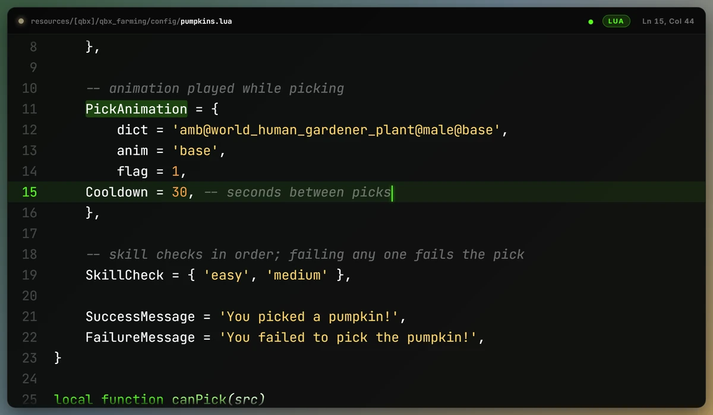 | 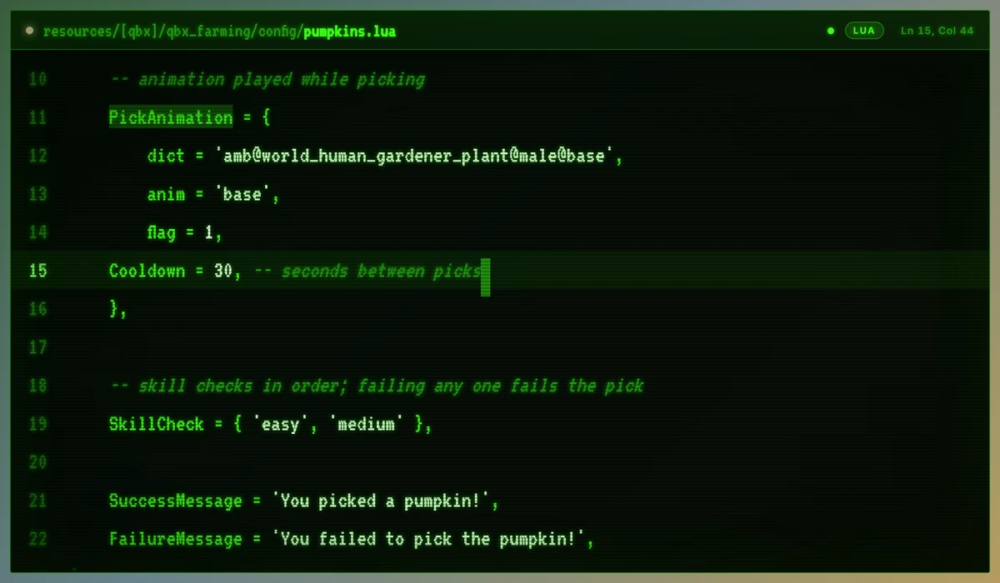 |
| 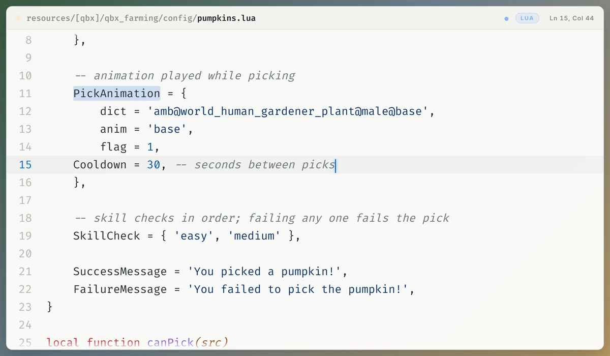 | 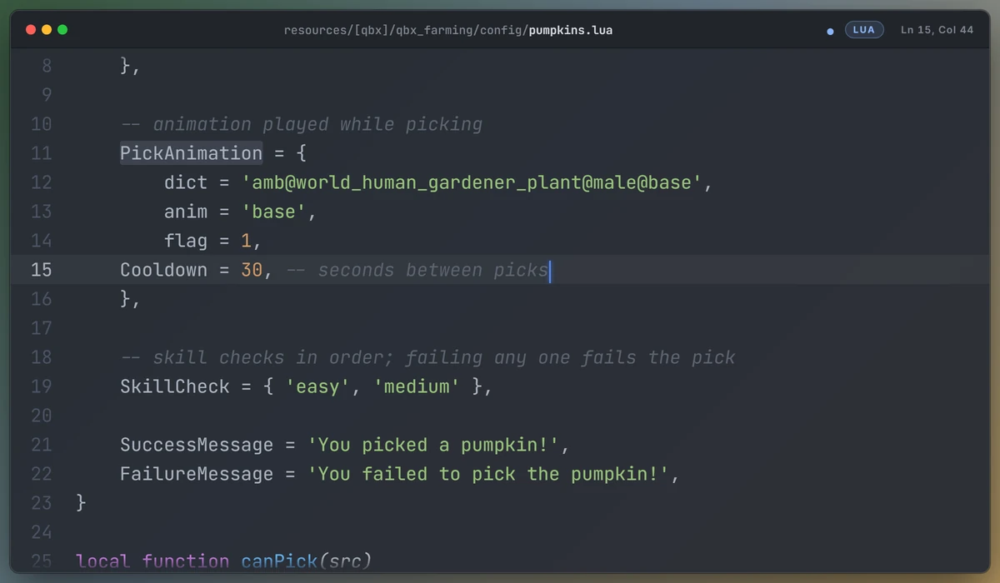 |

Mocha, Kick, Twitch, Terminal, Paper, Glass, Neon, Mac, Nord, Dracula, Gruvbox and Minimal.

## 3D

| | |
| --- | --- |
| 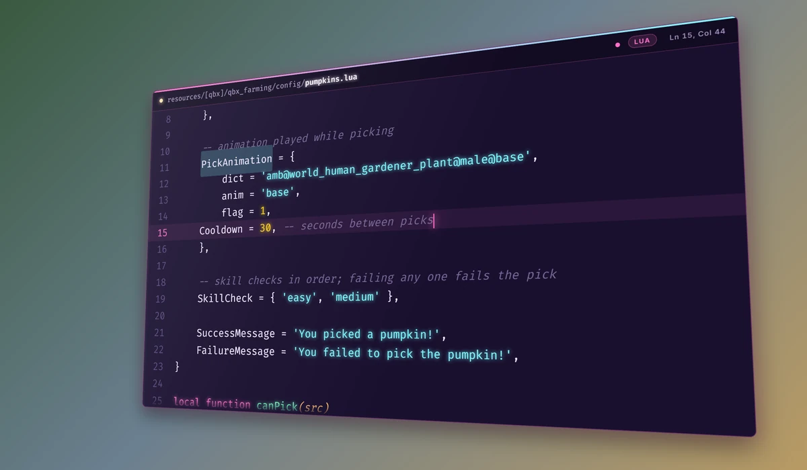 | 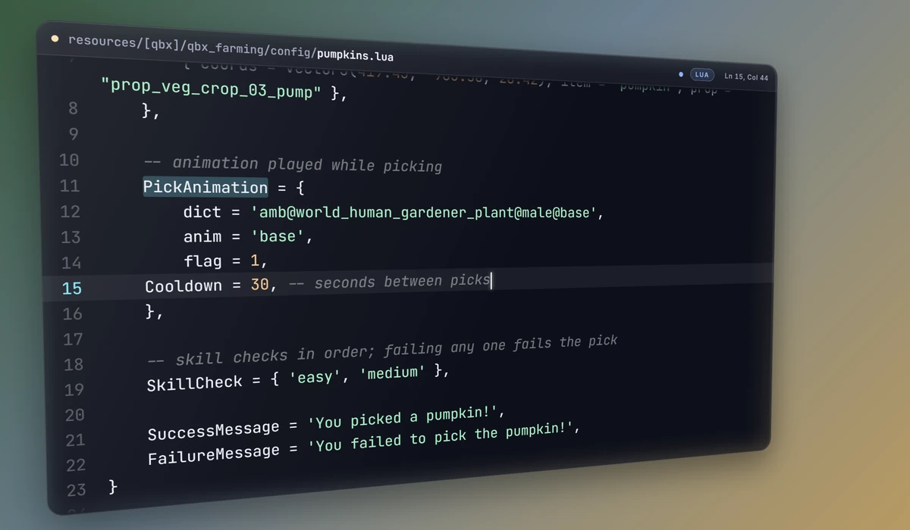 |

Tilt X / Tilt Y / Rotate in degrees, perspective distance, scale, depth (the thickness and
sheen), float and opacity. Something like tilt Y −22, tilt X 6, depth 14, scale 0.9 gives
a game-HUD look.

## Zoom

| | |
| --- | --- |
| 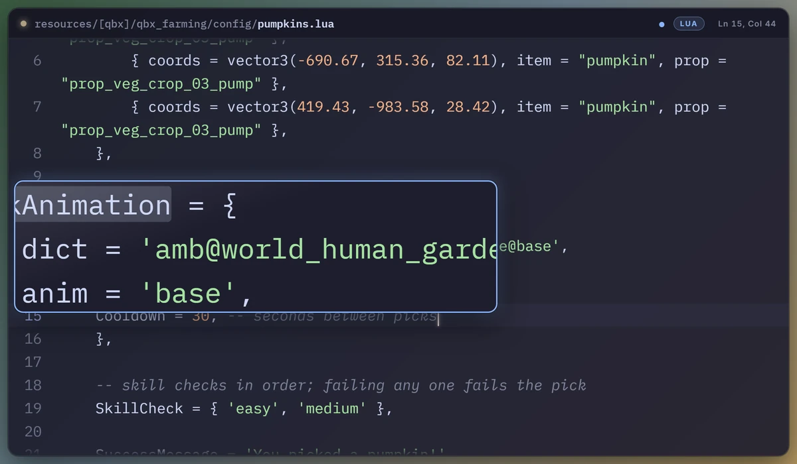 | 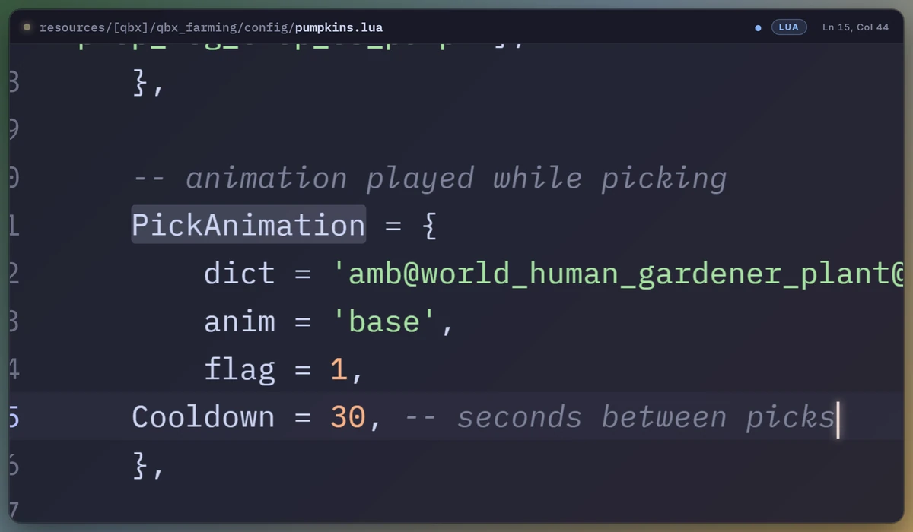 |

Point at a line with the mouse to show viewers exactly what you mean. **Lens** puts a
magnifier over the spot and leaves the rest of the view as it is. **Camera** zooms the
whole view in and pans to follow. By default the zoom follows whichever moved last, the
mouse or the text cursor, so it is on the line you are typing as soon as you type again.
**Zoom out after** eases back to the full view after a few quiet seconds, so the zoom only
appears while something is happening.

VS Code doesn't tell extensions where the mouse is, so "the mouse" means the spot where it
last rested over code (the moment a hover tooltip would appear) or clicked. It never adds a
tooltip of its own. If you turned `editor.hover.enabled` off, only clicks count.

## Just the code

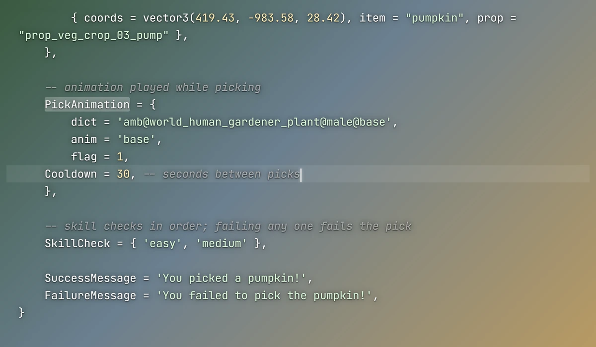

The Minimal theme, or the **Show background** / **Show header** / **Show line numbers**
settings turned off on any theme, leaves only the code floating over the game with a soft
shadow for legibility. Turn **Edge fade** up (around 25) and the code dissolves into the
game at the top and bottom instead of being cut off.

## The gallery / control panel

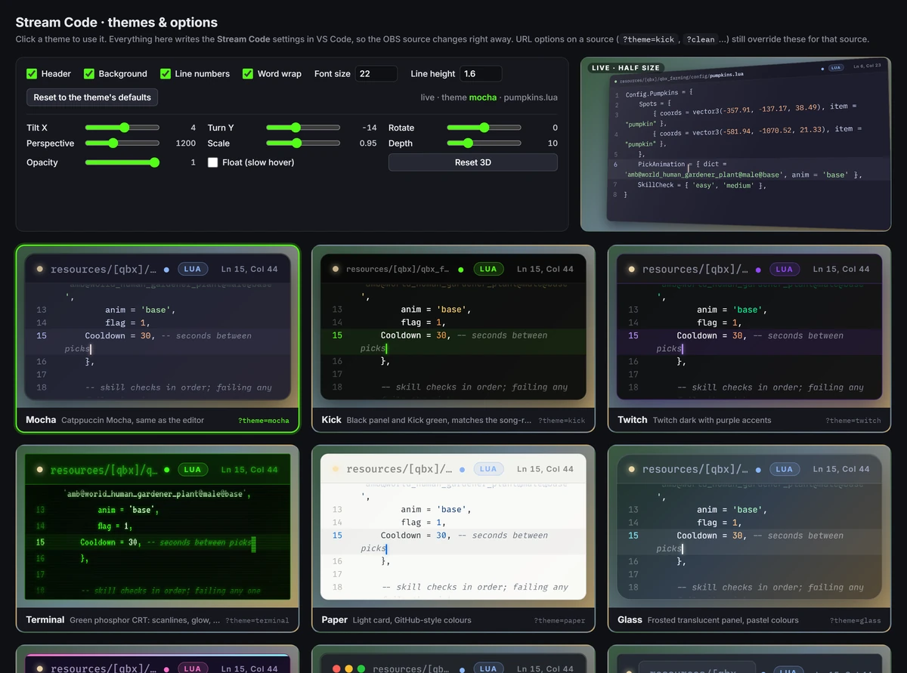

`http://127.0.0.1:7331/?gallery`: every theme on the same code, the option toggles, the 3D
sliders, the zoom controls and a half-size live preview of the real overlay. Everything on that page writes
the VS Code settings through the extension.

## Private files

Files matching `streamCode.hideFiles` never leave VS Code: the overlay shows a lock card
instead of their contents.

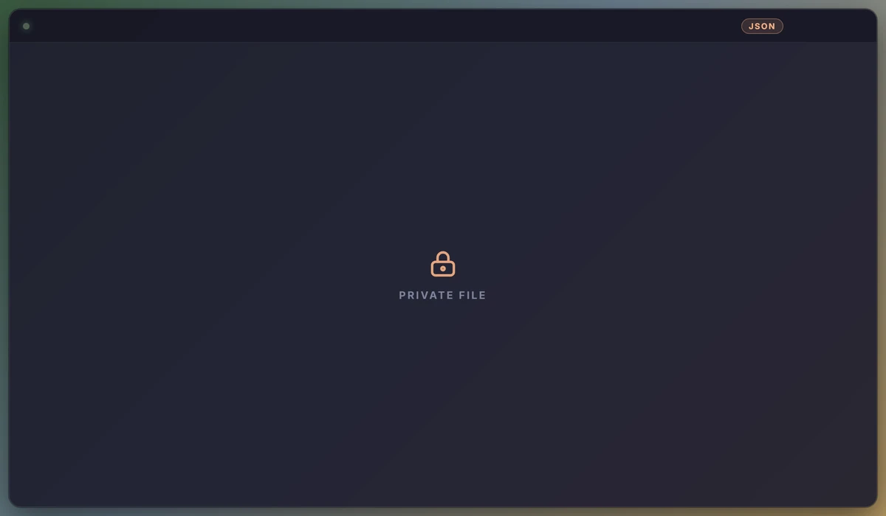

## Settings

| Setting | Default | |
| --- | --- | --- |
| `streamCode.theme` | `mocha` | overlay theme |
| `streamCode.showHeader` | `true` | file-name bar |
| `streamCode.showBackground` | `true` | panel background, border and shadow |
| `streamCode.showLineNumbers` | `true` | line numbers |
| `streamCode.wordWrap` | `true` | wrap long lines (off: they slide sideways to follow the caret) |
| `streamCode.fontSize` | `22` | code font size in px |
| `streamCode.lineHeight` | `1.6` | line height multiplier |
| `streamCode.edgeFade` | `4` | % of the height that fades out at the top and at the bottom (0 = hard edges) |
| `streamCode.tiltX` / `tiltY` / `rotate` | `0` | 3D angles in degrees |
| `streamCode.perspective` | `1200` | 3D perspective distance in px (smaller = more dramatic) |
| `streamCode.scale` | `1` | scale of the whole panel |
| `streamCode.depth` | `0` | fake thickness in px (0 = flat) |
| `streamCode.float` | `false` | slow hovering motion |
| `streamCode.opacity` | `1` | opacity of the whole panel |
| `streamCode.zoom` | `off` | `camera` (whole view zooms and pans) or `lens` (magnifier) |
| `streamCode.zoomFollow` | `both` | `both` (whichever moved last), `mouse` or `cursor` |
| `streamCode.zoomAmount` | `1.8` | magnification, 1.1 to 4 |
| `streamCode.zoomOutAfter` | `0` | quiet seconds before the zoom eases out (0 = stay zoomed) |
| `streamCode.port` | `7331` | local port |
| `streamCode.bufferLines` | `50` | lines sent above and below the cursor |
| `streamCode.maxLineLength` | `400` | longer lines are cut before sending |
| `streamCode.hideFiles` | `.env*`, secrets, keys... | globs that are never broadcast |
| `streamCode.overlayPath` | empty | serve your own copy of the overlay HTML instead of the bundled one |

URL options on the browser source (`?theme=kick`, `?clean`, `?size=26`, `?tilty=-20`, `?zoom=lens`...)
override the settings for that one source, so two scenes can use two looks.

## How it works

The extension hosts a tiny HTTP server on `127.0.0.1:7331` and streams the editor state over
Server-Sent Events to `overlay.html`, a single self-contained page it also serves. Syntax
colours come from highlight.js; fonts from Google Fonts (IBM Plex Mono, JetBrains Mono,
Fira Code, VT323, Inter), with Consolas as the offline fallback, so the overlay page
fetches those from public CDNs; your code itself is never sent anywhere but your own
machine. There is no telemetry.

## Support

Need help, found a bug, or want a feature? Join the Discord:
**[discord.gg/8wwfPxfMWA](https://discord.gg/8wwfPxfMWA)**

Made by heyjeay for the FiveM dev streams on Kick and Twitch.
